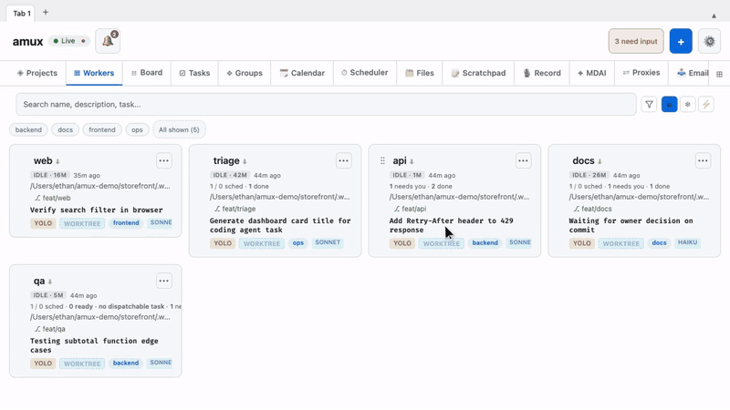
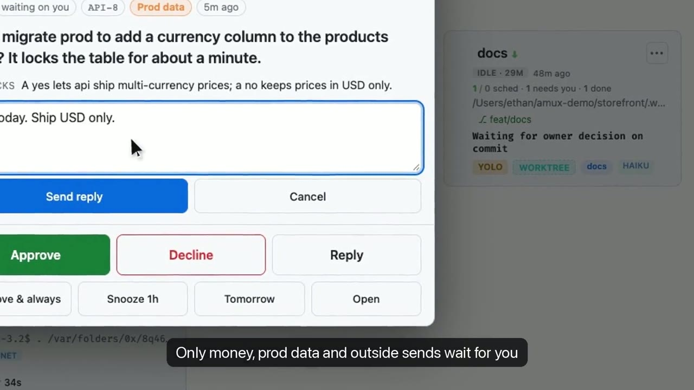

<p align="center">
  <a href="https://github.com/mixpeek/amux/stargazers"></a>
  <a href="LICENSE"></a>
  <a href="https://amux.io"></a>
</p>

**Run an AI engineering team.** amux runs Claude Code, Codex and Gemini CLI agents in parallel from one dashboard or your phone. They share a task board, message each other, recover from crashes, and keep shipping while you sleep.

## Install

```bash
curl -fsSL https://amux.io/install.sh | bash
```

Then open **https://localhost:8824**. It clones amux to `~/Dev/amux`, asks before installing anything (Rust, tmux), and keeps your data in `~/.amux`.

You need tmux 3.2+ and at least one agent CLI (Claude Code, Codex or Gemini CLI). Runs on macOS and Linux. Prefer to read first? `git clone https://github.com/mixpeek/amux && cd amux && ./install.sh` does the same thing.

## amux Cloud

Your own always-on amux server at `yourname.amux.io`, so agents keep working when your laptop sleeps and you steer them from your phone. Same product, we run the box. Bring your Claude, ChatGPT or Gemini account, or an API key.

| Plan | Price | Server |
|---|---|---|
| Solo | $39/mo | 4 vCPU, 8 GB RAM |
| Team | $69/mo | 8 vCPU, 16 GB RAM (for freelancers, agencies and small teams) |
| Max | $129/mo | 16 vCPU, 32 GB RAM |

**[Start amux Cloud](https://amux.io/start/?source=github)** · [Pricing](https://amux.io/pricing/)

Already running amux locally? `amux export`, then `amux import <file> --to https://<you>.amux.io` moves your setup over.

## Apps

Every app connects to your amux server (or your amux Cloud address).

| Device | Get it |
|---|---|
| **Mac** (macOS 12+, Apple silicon and Intel) | [Download Amux-macOS.zip](https://github.com/mixpeek/amux/releases/download/desktop-latest/Amux-macOS.zip), or install with the one-liner below |
| **iPhone and iPad** | [App Store](https://apps.apple.com/us/app/amux-agent-multiplexer/id6760410435) (one app for both) |
| **Android and any browser** | Open your dashboard URL and choose **Install app** or **Add to Home Screen** |

Mac, one command:

```bash
curl -fsSL https://github.com/mixpeek/amux/releases/download/desktop-latest/Amux-macOS.zip -o /tmp/Amux-macOS.zip && ditto -x -k /tmp/Amux-macOS.zip /Applications && open /Applications/Amux.app
```

The Mac app is a native window on the system WebKit (about 1.5 MB). It opens several windows and tabs, keeps pinned notes floating above other apps, shows a menu bar readout and a Dock badge when agents need you, and toggles with Control-Option-Space. Every window keeps its place: quit, crash or restart and each one reopens on the same display and Desktop, showing the same worker, tab or file. Save the arrangement as a named workspace and switch with Control-Command-1 to 9. Windows snap to a grid as you drag, and Window > Arrange tiles them. It is not notarized yet: if you download the zip in a browser, macOS blocks the first open, so go to System Settings, Privacy & Security, and click **Open Anyway**. To build it yourself: `make desktop`.

<p align="center"><a href="https://amux.io"></a></p>

<p align="center"><a href="https://amux.io/walkthrough/"></a><br/><a href="https://amux.io/walkthrough/"><b>▶ Watch the walkthrough</b></a> (desktop and phone, with transcript)</p>

## What your agents get

- **A shared task board.** Claiming a card is atomic, so two agents never grab the same work.
- **Messages to each other.** Agents ask, hand off and unblock peers without you relaying.
- **Self-healing.** Crashed or stuck sessions restart and pick up where they left off.
- **Schedules and loops.** `daily at 9am`, `every 15m`, or overnight runs that pace themselves.
- **Your phone, tablet and Mac.** Watch, steer and approve from the [iPhone and iPad app, the Mac app](#apps) or the browser.
- **Any model.** Claude Code, Codex, Gemini CLI, OpenCode or Ollama, switchable per worker.

Local-first: one Rust binary and SQLite on your own machine.

## Learn more

<<<<<<< HEAD
`install.sh` also installs the Bash `amux` client. To update just that client
from a resolved, reviewed checkout, run `make install-cli` (optionally
`BIN_DIR=/usr/local/bin`). It checks a private snapshot before atomic publication;
invalid source leaves the installed client intact. Do not point the installed
client at a mutable checkout with a symlink.

`amux-rs` finds the server via `--url`, then `$AMUX_RS_URL`, then `$AMUX_URL` (every running amux session has it), falling back to `https://localhost:8824` — the port `./install.sh` configures. So a bare invocation just works:

```bash
amux-rs health                                        # no env or flags needed
amux-rs board add "task title" --type code
amux-rs board list --status todo
amux-rs board doing PROJ-1
amux-rs board done PROJ-1 --checked "Tests / lint pass"   # gates are surfaced loudly, never bypassed silently
amux-rs workers list
amux-rs send worker-1 "implement the login endpoint and report back"
amux-rs schedules list
```

Board mutations are gate-aware: a 409 from a status gate prints the checklist and the exact retry command instead of failing silently.

## Configuration

Server configuration lives in `~/.amux/server.env` (plain `KEY=value`; process env wins). Highlights:

| Variable | What |
|---|---|
| `AMUX_RS_PORT` | server port (installer sets 8824) |
| `AMUX_HOME` | data dir (default `~/.amux`) |
| `AMUX_DB` | SQLite path (default `$AMUX_HOME/amux.db`) |
| `AMUX_HERDR_SESSION` | herdr session hosting amux workspaces (enables the herdr backend) |
| `AMUX_REQLOG_RETAIN_DAYS` | request-log retention (default 14) |
| `AMUX_SCOPE_WRITE_AGENTS` | `1` lets agent sessions write group/global scope layers (default: only their own worker layer) |

[`server.env.example`](server.env.example) documents the full set. Never commit your real `server.env` — several values are secrets.

## macOS permissions

amux drives a few system apps on your behalf, and macOS gates each one behind
TCC. Each grant below is load-bearing. Without it the feature hangs or fails
silently rather than reporting a problem. Granting them takes about two minutes, and
they are listed **most-unblocking first** so you can stop when you have what you
use.

Everything is under **System Settings → Privacy & Security**.

### 1. Automation → Messages  *(the urgent owner alert)*

**Grant:** Privacy & Security → Automation → find your terminal (iTerm, Terminal)
and the `amux-server-rs` entry → tick **Messages**.

**Without it:** `amux alert` cannot text you. The send *hangs* for the full 12s
timeout on every page, so the fire alarm is slowest exactly when it matters. amux breaks the circuit after the first timeout and says so in the
channel map, but the message does not arrive.

**Also check:** Messages must be *signed in to iMessage* (Messages → Settings →
iMessage). AppleScript can accept a `send` against a signed-out account and report success,
so treat the grant and the delivery as two separate things to confirm.

### 2. Automation → iTerm2  *(creating and inspecting workers)*

**Grant:** Privacy & Security → Automation → your terminal → tick **iTerm2**.

**Without it:** `amux start`, the worker grid and pane discovery cannot see or
place panes. `worker_create.rs` asks iTerm2 to list panes and gives up after 5s.

### 3. Full Disk Access  *(reading Messages history, Mail, Calendar stores)*

**Grant:** Privacy & Security → Full Disk Access → add your terminal **and**
`~/.local/bin/amux-server-rs`.

**Without it:** reads of `~/Library/Messages/chat.db` and the Mail/Calendar
stores fail with `authorization denied`. Anything that reconciles what was
actually delivered against what amux believes it sent is blind.

### 4. Automation → Mail  *(only if you use a non-Gmail account)*

**Grant:** Privacy & Security → Automation → your terminal → tick **Mail**.

**Without it:** nothing, if your accounts are Gmail or Workspace. Those go through
the Gmail API and never touch Mail.app. This is the fallback path only.

### 5. Accessibility  *(only if you use keystroke automation)*

**Grant:** Privacy & Security → Accessibility → add your terminal.

**Without it:** anything driving another app through System Events keystrokes
fails. Core amux does not need this; grant it if a worker of yours does.

### What amux does NOT need

Camera, Microphone, Location, Contacts, Reminders, Photos. If something asks,
it is a worker's own tooling and not the harness. Browser automation uses a
dedicated Chrome profile over CDP, so it needs no Screen Recording grant either.

### After granting

macOS caches TCC decisions per binary. The auto-builder replaces
`amux-server-rs` on every commit, and an ad-hoc-signed rebuild reads as a *new
program*, so prompts can reappear. Provisioning the stable local signing identity
using the owner step printed by `bash scripts/codesign-identity.sh --owner-provision`
makes an approval stick across rebuilds.

Verify a grant by what it *did*, not by the checkbox:

```bash
amux alert "permissions test" "verifying Automation for Messages"
curl -sk $(amux url)/api/alert/owner | head -c 400   # read the channels map
```

### Evidence this list is real

Measured across ~1.5 GB of fleet logs on 2026-09-01, counting only machine-emitted
signatures (prose describing an error cannot match these):

| Signature | Count |
|---|---|
| `(-1712)` AppleEvent timed out | 166 |
| `kTCCServiceScreenCapture` | 12 |
| `Operation not permitted` | 9 |
| `Not authorized to send Apple events` | 6 |
| `errAEEventNotPermitted` | 5 |

An earlier pass over the same logs reported far larger numbers. It was matching
this document's own prose being echoed back through the message log, which is why
the counts above are restricted to strings a human report would not contain.

## Naming

A **worker** is one agent lane. A **group** is a label shared by several workers; workers see and coordinate with same-group peers. The HTTP API and env vars still carry the older `session`/`tag` spellings (`/api/sessions`, `X-Amux-Session`, `CC_TAGS`); renaming them would break every running worker at once, so the wire names migrate behind aliases. Worker = session, group = tag, wherever you see them in a request.

## Security

Local-first. Auth is a bearer token minted at `~/.amux/auth_token` (localhost callers are exempt). **Never expose port 8824 to the internet** — use [Tailscale](https://amux.io/guides/remote-access-tailscale/) for phone/remote access, or the [amux tunnel](https://amux.io/features/tunnel/) for deliberately-public endpoints (tunneled URLs are unguessable, not authenticated). Report vulnerabilities privately per [SECURITY.md](SECURITY.md).

---

## LEGACY: the Python server

> The Python predecessor (`amux-server.py`) was **removed at commit `792ce1f`** (2026-08-09) — git history has it, and [docs/rust-migration/](docs/rust-migration/) records how the Rust server replaced it (the Rust binary also answers the legacy 8822, but that bind is a countdown, not an address — `GET /api/debug/legacy-port` reports who still calls it and when it can be dropped. Use 8824).
> `cloud/` still runs the last-built Python image pending its own Rust migration; do not build anything new on it.
> Historical install channels that shipped Python (`pipx install amux`, Homebrew) are retired — install with `./install.sh`.

---

## Roadmap & contributing

amux is growing into the durable operating system around agents: it owns execution, state, isolation, recovery, observability, and verification, so the model only has to own reasoning. The plan lives in [the roadmap epic (#46)](https://github.com/mixpeek/amux/issues/46); the seams are maintainer-owned, and the leaves they unlock (provider adapters, verification runners, MCP tools, eval scenarios, policy hooks) are great contributor work. See [CONTRIBUTING.md](CONTRIBUTING.md) and the [`help wanted`](https://github.com/mixpeek/amux/labels/help%20wanted) issues.

## Resources

- [Getting started](https://amux.io/guides/getting-started/) · [Running 10+ agents](https://amux.io/guides/running-10-plus-agents/) · [Agent-to-agent orchestration](https://amux.io/guides/agent-to-agent-orchestration/) · [REST API reference](https://amux.io/guides/rest-api-reference/)
- [Board system guide](docs/guide.md) (columns, types, gates, `done` vs `verified`)
- [Remote control over Tailscale](REMOTE.md) · [Calendar sync](docs/calendar-sync.md)
- [How amux compares](https://amux.io/compare/) · [Use cases](https://amux.io/use-cases/) · [FAQ](https://amux.io/faq/)
- iOS app: [App Store](https://apps.apple.com/us/app/amux-agent-multiplexer/id6760410435) · Managed onboarding: [amux.io/concierge](https://amux.io/concierge/)
=======
- [Getting started](https://amux.io/guides/getting-started/) · [Docs](https://amux.io/docs/) · [How amux compares](https://amux.io/compare/)
- [Self-hosting reference](docs/self-hosting.md): commands, Linux services, architecture, CLI, config, macOS permissions, security
- [Contributing](CONTRIBUTING.md) · [Roadmap (#46)](https://github.com/mixpeek/amux/issues/46) · [Security policy](SECURITY.md)
>>>>>>> upstream/main

If amux saves you time, a ⭐ helps others find it.
