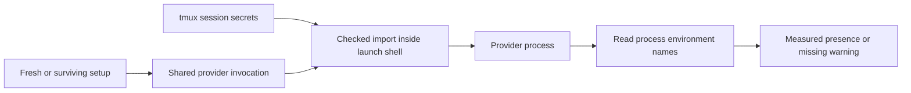

# Worker token launch evidence

PR 95 review fixes and their verification are recorded in
[worker-token-review-fixes.md](worker-token-review-fixes.md). The evidence below
describes the original candidate before those fixes.

Candidate: `fix/worker-token-every-launch`, based on `33594ab48`.
Tracking: maxtongwang/ai-config#982 F6, refs maxtongwang/ai-config#981.

The silent import failure is reproduced; the specific cause of the supplied
live mrpopo incident remains unproved. No skipped initial import was found in
this baseline. This candidate hardens the shared invocation boundary and adds
the requested process check. It is not a completed lifecycle verification.
Risk: high, because this changes credential delivery and worker identity diagnostics.

## Caller coverage

Method: repository-wide searches for `provider_command_in_workspace(`,
`native_status::begin_launch`, and `start_session(`, followed by reading each
production provider invocation, its setup branches, and the named entry paths.
Line numbers below refer to this candidate; original defect lines are identified
against the baseline because the old closure was removed.

| Path | Evidence | Import behavior |
| --- | --- | --- |
| Initial provider command | `api/session_verbs.rs:16968` | Both fresh and surviving branches converge here |
| Claude resume-to-fresh fallback | `api/session_verbs.rs:17092` | Previously depended on earlier shell import; now embeds the same checked import |
| Codex update retry | `api/session_verbs.rs`, `session.codex_update_relaunch` | Reuses the initial command, including the checked import |
| Board dispatch | `api/session_verbs.rs:17395` | Calls `start_session` |
| Auto-wake on send | `api/session_verbs.rs:13537` | Calls `start_session` |
| Interrupted startup | `resume_interrupted_starts` | Calls `start_session` |
| Config/provider restart | `restart_for_swap`, `api/session_verbs.rs:32772` | Calls `start_session` |
| Resume and remote control | `claude_session_flag`, `api/session_verbs.rs:3382` | Flags on the same command, not another spawn path |
| Compaction | `orchestrator/compaction.rs`, compaction handling in `session_verbs.rs` | No separate provider-command or begin-launch call; controller restart/recycle paths use `start_session` |
| Native status launch | `api/session_verbs.rs:16943` | Records observation identity, not another provider spawn |
| Chat adapter begin-launch | `api/chat_worker.rs:567` | Marks chat ready; actual turns use `spawn_detached` with the existing `staged_env` vault import at `chat_worker.rs:1504` |

No alternative interactive launcher without setup was found. The two production
`provider_command_in_workspace` call sites previously contained **no import of
their own**; initial setup imported in both branches. Their reliance on inherited
shell state, rather than a per-invocation import, is now removed.

The token is appended to `vault_values` at baseline `session_verbs.rs:16632`,
before `vault_keys` is built at `:16637`. Both branches use that same vector.
This lead was ruled out by code inspection.

Unavailable sources: the supplied on-disk handoff directory and
`~/.amux/settings/mrpopo-compact-1m.json` do not exist on this build host. The
pasted handoff was read. No live process, tmux session or amux state was changed.
GitNexus is installed but this clone is not indexed. Project memory routing has
no amux entry; installed home memory is absent. The fallback home memory and
canonical builder role were read. pstack is not installed here; no Codex pstack
build is available. Failure-history lookup was refused on its `.lock`; it was
not treated as an empty history.

## Defect and change

Baseline `session_verbs.rs:16646–16657` generated:

```sh
eval "$(tmux show-environment -s -t '=amux-fixture' AMUX_WORKER_TOKEN)"
```

An isolated fake tmux exiting 1 reproduced `import_status=0 token_present=` in
both `/bin/bash` and `/bin/zsh`. The command substitution failed, but `eval` of
its empty output succeeded. `shell_command_with` therefore could acknowledge
successful setup with no imported token. This is a confirmed defect consistent
with the handoff's symptoms, not proof that a particular live tmux read failed.

`worker_launch_env::import_command` checks the tmux status and nonempty output,
unsets any obsolete inherited value, evaluates the assignment, checks that the
key was defined and explicitly exports it. Failure exits the launch child with
125 and a names-only `vault_env_import_failed` marker. One generated program
runs inside the final shell for every initial/fallback/retry invocation.
Shell tracing is disabled before secret imports. Vault running manifests are
recorded only after provider liveness is confirmed.

The stale-key sweep also previously filtered the server-owned token through
`vault_secrets::valid_key`, which deliberately rejects all `AMUX_*` keys.
The shared import-key validator allows exactly the worker token in addition to
ordinary valid vault keys, so leaving rule 10 can actually unset its token.

After a rule-10 provider becomes live, the launcher restricts discovery to its
pane's process tree, identifies the provider rather than a shell, and reads
environment **names only** with macOS `KERN_PROCARGS2` or Linux `/proc`.
Missing token: WARN `worker_token_missing_in_process`, `measured=true`,
`n_considered=1`. Unreadable/unresolved process: WARN
`worker_token_process_check_unmeasured`, `measured=false`, `n_considered=0`.
Values and argv are never logged.



## Verification status

- Initial offline build hit the macOS compiler's inaccessible default temp
  directory. The same offline build was restarted with `TMPDIR=/private/tmp`;
  dependencies were found in the existing cache. Cargo files were not changed.
- The private tmux socket probe failed with `Operation not permitted`, even
  though `new-session` returned 0. A subsequent `has-session`/read-back failed;
  the new tests require that read-back and do not ignore this failure.
- Own-process `KERN_PROCARGS2` size probe succeeded.
- `TMPDIR=/private/tmp CARGO_BUILD_JOBS=2 cargo build --offline -p amux-server`
  returned 0: `Finished dev profile [unoptimized + debuginfo] target(s) in 21m 15s`.
  One linker warning: the unwind section exceeds the compact-unwind encoding
  limit. This first pass preceded the final self-review edits; the successful
  final-source build is recorded below.
- `TMPDIR=/private/tmp CARGO_BUILD_JOBS=2 cargo test --offline -p amux-server worker_token_`
  was interrupted via native session control (exit 130) before tests ran,
  after measured host memory pressure and slow concurrent server compilations.
  Its compile output is preserved; this is not a regression verdict.
- `TMPDIR=/private/tmp CARGO_BUILD_JOBS=1 cargo test --offline -p amux-server --lib worker_token_`
  completed using one compiler job and only the unit-test target. First result: 5 passed, 4 failed, 0 ignored,
  4157 filtered out, execution 0.10s; compile 28m 34s. All four failures were the
  mandatory private-tmux socket read-back before any token assertion. The
  socket-free failed-import, empty/unset-output, exported-child/stale-removal,
  names-parser and real-child missing-token warning cases passed.
- The first negative control was invalid: the old standalone emitter was
  embedded without its original command boundary, so even its export positive
  control failed. Its red result is excluded. The mutation driver confirmed
  exact source restoration. This was a test-control construction error, not a
  production regression.
- Corrected negative control completed: the original unchecked emitter
  (including its original submission newline), plus omission of the report
  call, produced **2 passed, 7 failed, 0 ignored**. Parser and exported-child
  positive controls passed. Both import-failure assertions observed exit 0
  instead of 125; the actual-child diagnostic assertion observed no warning.
  The other four failures were the unchanged private-socket infrastructure
  failures. The mutation trap restored the source, and the driver verified its
  exact SHA-256. This is a controlled emitter/report mutation, not a complete
  pre-fix-tree lifecycle run.
- Restored final-source filter completed, exit 101: **5 passed, 4 failed,
  0 ignored**, 4157 filtered out, execution 0.08s; compile 9m 13s. All four
  failures now explicitly include `create=... (Operation not permitted)` and
  a failed private-socket read-back, before any token assertion.
- All nine `worker_token_` test functions were found under `src/`, with none
  under `tests/`; `--lib` avoids unrelated target compilation without dropping
  a matching test case.
- Final additional checks and build completed successfully (commands below).
- Existing `e2e/chaos/observed-edits-identity-recovery.mjs`, with the built binary,
  a unique `tmux -L` wrapper and private harness state: exit 1 before provider
  launch, `listen EPERM: operation not permitted 127.0.0.1`. No lifecycle claim
  follows from this infrastructure failure.

The private-tmux cases exercise the shipped `shell_command_with`, shared
provider command and token mint/hash storage with a fake provider: fresh start,
restart retaining the same pane PID and rotating the token, `--resume`, and a
missing-import negative control checking the warning. They do not exercise the
entire HTTP/controller lifecycle. Additional socket-free cases cover import
failure, empty/unset output, child inheritance/stale removal, parser boundaries
and an actual child-process warning without exposing environment values.

Remaining acceptance evidence: private-tmux lifecycle passes and a per-case
red/green lifecycle run against the pre-fix tree. Sandbox-denied socket creation is
not evidence that those regression assertions detect the original incident.
The existing `observed-edits-identity-recovery.mjs` scenario is infrastructure-blocked.
The wrapper owns commits, independent review and PR creation.

## Final check results

All commands used `TMPDIR=/private/tmp CARGO_BUILD_JOBS=1`; no network or Cargo
file changes. The mutation source was restored before these commands.

| Command | Actual result |
| --- | --- |
| `cargo test --offline -p amux-server --lib worker_token_` | 5 passed; 4 infrastructure failures; 0 ignored |
| `cargo test --offline -p amux-server --lib spawn_argv_secret_tests` | 11 passed; 0 failed; 0 ignored |
| `cargo test --offline -p amux-server --lib isolated_launch_scrubs_inherited_harness_routing_but_keeps_provider_auth` | 1 passed; 0 failed; 0 ignored |
| `cargo test --offline -p amux-server --lib provider_launch_and_recovery_pin_workspace_even_after_shell_profile_changes_dir` | 1 passed; 0 failed; 0 ignored |
| `cargo build --offline -p amux-server` | Exit 0; finished dev profile in 4m 38s |
| `rustfmt --check --edition 2021` on both new Rust files | Exit 0 |
| `git diff --check` | Exit 0 |

Total distinct test cases: 18 passed, 4 required
lifecycle cases blocked. The test command is **not green**. One linker warning
remains: `__eh_frame section too large ... compact unwind table`.

| Socket-free case | Corrected negative control | Restored source |
| --- | --- | --- |
| Failed tmux import refuses provider | FAILED: exit 0, expected 125 | PASS |
| Empty/unset output refuses obsolete token | FAILED: exit 0, expected 125 | PASS |
| Actual child without token emits measured warning | FAILED: no warning | PASS |
| Exported child token and stale-key removal | PASS | PASS |
| Names parser and provider selection | PASS | PASS |

The four private-tmux cases fail at socket creation on both sides; they are
excluded from regression claims, remain enabled, and have no skip/ignore or
weakened assertion. This control does not establish the live incident's cause.

The OAuth suppression remains after the shared import. Isolated launches scrub
an inherited worker token. The import now runs inside the provider launch child;
that step does not persist its values into the interactive parent shell.

Updated surfaces: provider launch code, the new environment probe and tests,
`docs/orchestration-contract.md`, this evidence note, and the linked entry in
`frustrations.md` (left open). Not updated: external issues #981/#982, the absent
original handoff files, central test-results records (lock refused), or live
worker/server state. No commit or PR was created; the wrapper owns those steps.

## Verified source hashes

These identify the uncommitted source bytes used by the final checks; they are
not an independent review verdict or exact-pushed-SHA merge evidence.

| Source | SHA-256 |
| --- | --- |
| `crates/amux-server/src/api/mod.rs` | `8dd4f9b020178375464d697f08fc207348abcf8f67fc64c89c147b90db58fcc4` |
| `crates/amux-server/src/api/session_verbs.rs` | `836a84cd96b4898ca24a16b75d9102e4b745b9427e09e2ff497f86885f5f6919` |
| `crates/amux-server/src/api/worker_launch_env.rs` | `1696256f905481cdf28867720e00ee82d2fb830169281a7a67e75498b222b614` |
| `crates/amux-server/src/api/worker_launch_env_tests.rs` | `9ac9f632e1a4909a0d954b92c8817cd03b32d517b7156e8dba30e32d3d39acae` |

## Time and usage

Wall time at the local-log snapshot: 109.5 minutes, from this session's recorded start. Claude weekly and Codex 7-day percentages before→after were not measured (offline scope). `scripts/cost-equiv.py`, filtered to this checkout and the task window, priced 171 recorded requests at **$6.61 API-equivalent value**; no unpriced models or malformed records. Window: `2026-11-06T06:35:41.212Z` through `2026-11-06T08:25:13.314200+00:00`. Final-message tokens after that snapshot are not included.
